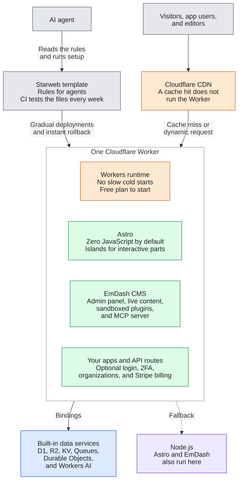
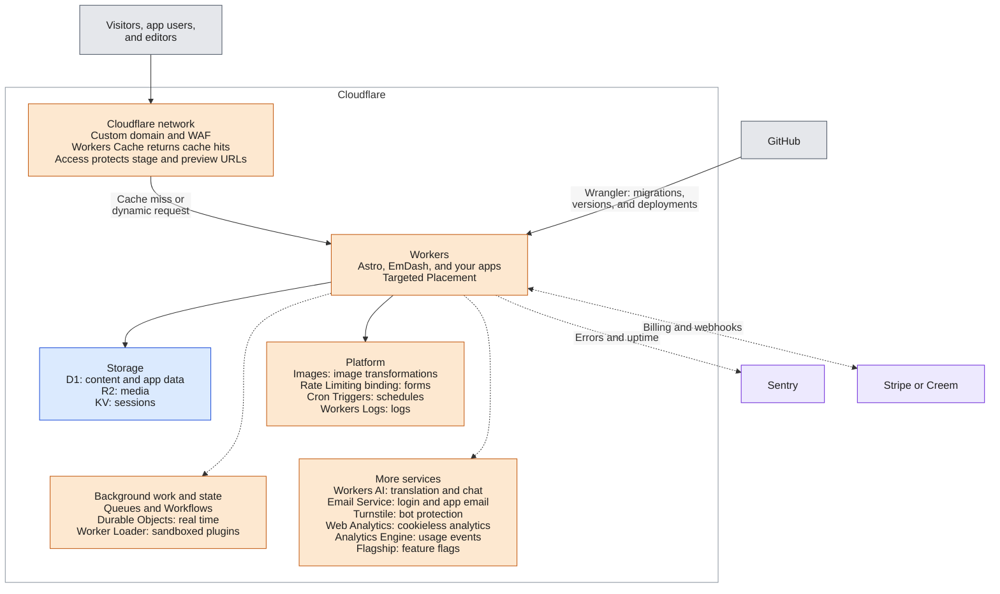
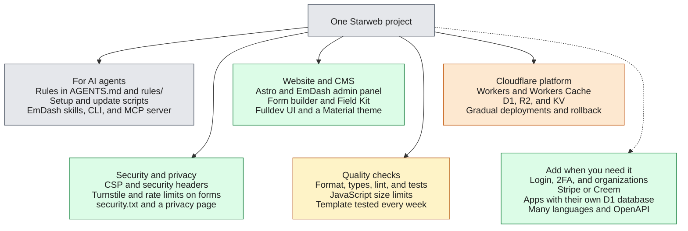
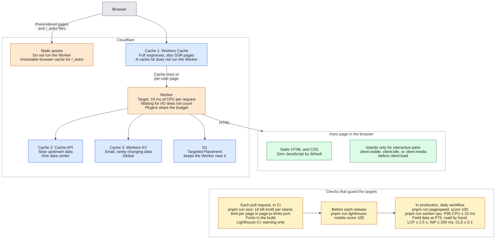
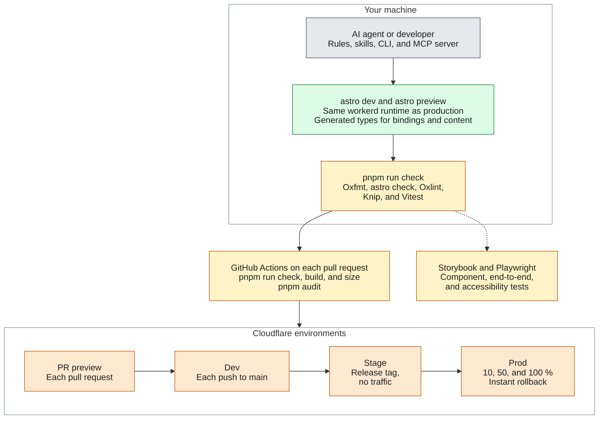
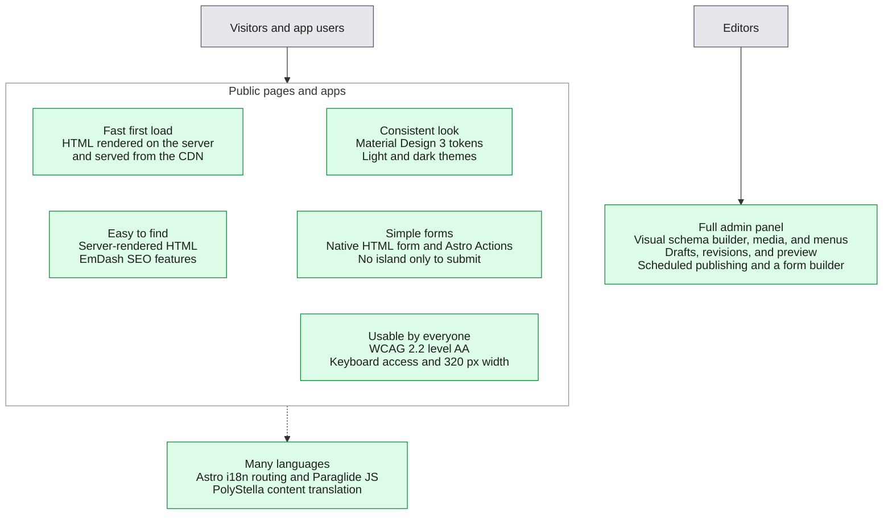
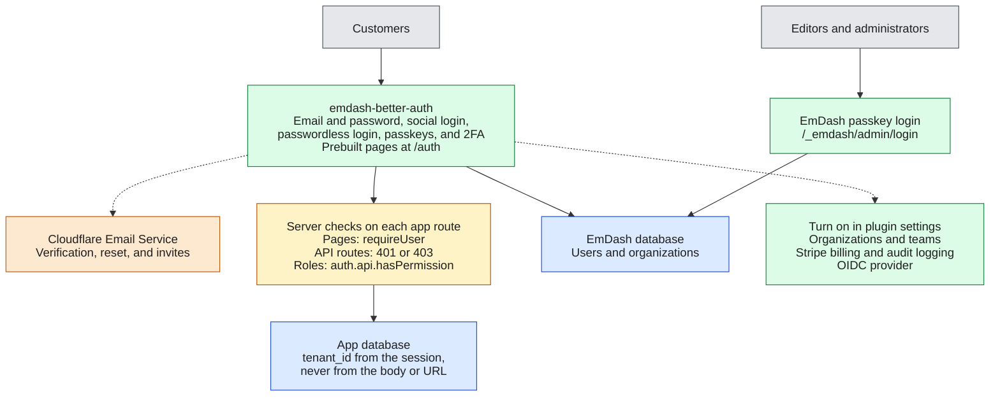
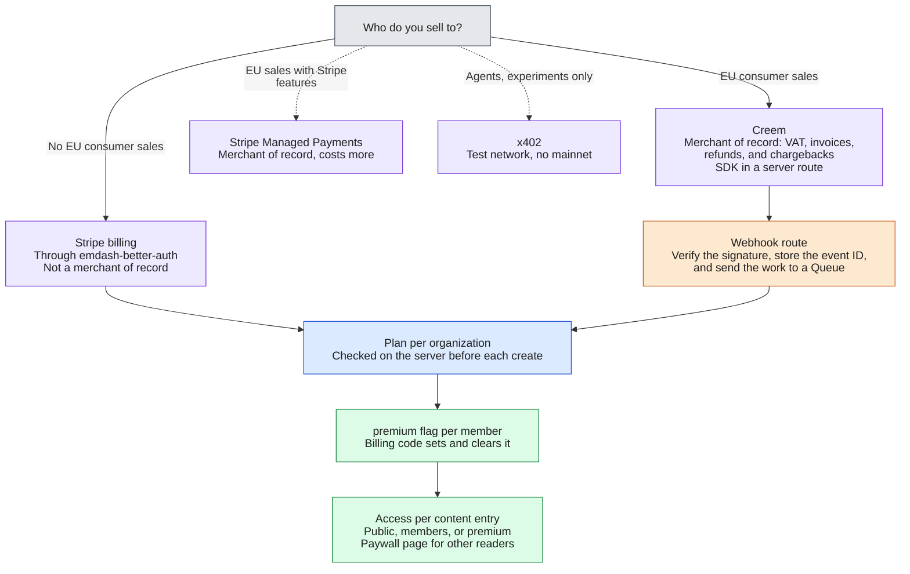
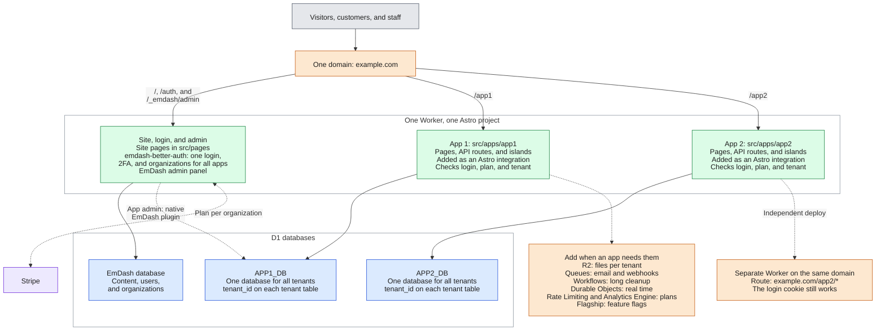

# ✨ Starweb

**[Star it](https://github.com/arinhubcom/starweb). [Fork it](https://github.com/arinhubcom/starweb/fork). [Change it](#-change-starweb).**

Starweb is a template for AI agents. Use it to build websites and web apps.
It is built on [Astro](https://astro.build) and
[Cloudflare Workers](https://workers.cloudflare.com), with [EmDash](https://docs.emdashcms.com/) as the CMS. Read [why we chose this stack](WHY.md).

## 🏁 Quick start

To set up a new project, give this prompt to your AI agent (Claude Code, Codex, Gemini CLI, or another agent):

```text
Set up a new Starweb project named my-site. Clone https://github.com/arinhubcom/starweb into a folder outside the project, for example ~/starweb, and keep it: setup.mjs reads it, and update.mjs needs it later. Do not use a temporary folder. Read AGENTS.md and rules/SETUP.md there. Ask me which optional parts to add. Run scripts/setup.mjs on the new project folder, then do the remaining steps in rules/SETUP.md in order. After each step, check the result. If a step fails, stop and report the error.
```

Replace `my-site` with your project name.

The steps are in [rules/SETUP.md](rules/SETUP.md). The agent first asks which [optional parts](#optional-parts) to add. The [template/](template/) folder holds the `create-emdash` output with the Starweb changes in place, Fulldev UI, `package.json`, the lockfile, and the tested configs. The new project takes it over: the script [scripts/setup.mjs](scripts/setup.mjs) copies the folder to the project root and writes a new encryption key. The rules hold decisions, not install commands. Each EmDash update runs `create-emdash` again: [scripts/update-starter.mjs](scripts/update-starter.mjs) merges the new output into `template/`, and [starter/](starter/) keeps the last output as the merge base. See the steps in [rules/UPDATE.md](rules/UPDATE.md#emdash-update). CI tests the template every week. Read [why](WHY.md#why-a-template-setupmjs-and-ci).

### Optional parts

The template holds what every project uses. The agent asks which of these parts you want, and it adds only those. You can add a part later.

- Sandboxed plugins (Workers paid plan).
- Queues for background work.
- Many languages: Astro i18n routing, Paraglide JS, and PolyStella.
- Customer login with emdash-better-auth: 2FA, organizations, and more.
- Email with Cloudflare Email Service: email verification, password reset, and app email.
- Apps with their own D1 database.
- An OpenAPI contract for an app.
- Stripe billing, or Creem for EU consumer sales.
- Sentry for errors and uptime.
- Storybook for components.
- Playwright and axe for end-to-end and accessibility tests.

Some parts need others: for example, Stripe billing needs customer login. The template also turns on scheduled publishing, and the agent asks whether to keep it.

## 🔄 Update a project

When Starweb has new rules or a better template, ask your AI agent in the project to update Starweb. The `starweb-update` skill finds your Starweb clone, pulls it, and follows the newest steps.

The steps are in [rules/UPDATE.md](rules/UPDATE.md). The script [scripts/update.mjs](scripts/update.mjs) merges the new rules and template files with your changes, and lists the rules that changed.

## 🔧 Change Starweb

To change your fork, give your AI agent one sentence that says what must be true when it finishes. For example, use this prompt with the [`/goal` command in Claude Code](https://code.claude.com/docs/en/goal):

```text
/goal Use Svelte instead of React for islands, update rules/ and template/, and make the Template CI workflow pass.
```

## 🏗️ Architecture

The diagram shows the main parts of a Starweb project and the main advantage of each part. All diagrams in this README use the same colors: orange for Cloudflare, blue for data and caches, green for pages and apps, gray for people and tools, purple for services outside Cloudflare, and yellow for checks.



### Platform services

The diagram shows the services that a deployed Starweb project uses on Cloudflare and outside it. Solid lines lead to services that every project uses. Dashed lines lead to services that you add when you need them. The deploy steps are in [rules/DEPLOY.md](rules/DEPLOY.md).



## 🚀 Features

- Rules and instructions in `AGENTS.md`, `CLAUDE.md`, `GEMINI.md`, and `rules/`.
- Built on Astro.
- Runs on Cloudflare Workers.
- Content managed with EmDash CMS.
- One prompt sets up a new project, and `update.mjs` merges new rules and template files with your changes.
- CI tests the template every week.
- Editors build forms and read submissions with the Forms plugin, and Field Kit gives better inputs for `json` fields.
- Security by default: CSP, security headers, `security.txt`, and Turnstile and rate limits on forms.
- Privacy by default: a privacy page to complete, and cookieless Web Analytics.
- Design rules: Fulldev UI, a Material Design 3 theme from one brand color, and WCAG 2.2 level AA.
- JavaScript size limits for each island and each page fail the pull request when you go over them.
- [Optional parts](#optional-parts) that you add when you need them: login, payments, apps, many languages, and more.

The diagram groups the main features. Solid lines show what every project gets from the template. The dashed line shows what you add during setup when you need it: read [rules/SETUP.md](rules/SETUP.md).



## ⚡ Performance

- SSR at the edge on Cloudflare Workers, with no slow cold starts.
- CDN cache through Astro route caching: a cache hit does not run the Worker.
- Zero JavaScript by default. Islands hydrate only the interactive parts.
- Zod schemas are compiled at build time.
- Performance budget: less than 10 ms of CPU time per request.

The diagram shows how a request gets through the page and cache layers, and which checks guard the targets. Read the details in [rules/PERF.md](rules/PERF.md).



CI blocks a pull request only for the JavaScript and font checks. Lighthouse CI runs in its own workflow and only warns. A daily workflow runs `pnpm run pagespeed` and `pnpm run worker-cpu` against production and fails when a target is missed. It does not block a build. You run `pnpm run lighthouse` before a release, and you read the field data. Field data decides.

## 🛠️ DX

- Built for AI agents: rules in `AGENTS.md` and `rules/`, EmDash agent skills, CLI, and MCP server.
- TypeScript in strict mode, with types generated for bindings (`wrangler types`) and content (`pnpm exec emdash types`).
- Effect for typed errors and Zod for validation.
- `astro dev` and `astro preview` run the same runtime (workerd) on your machine.
- Safe releases with gradual deployments and instant rollback.

The diagram shows the path of a change from your machine to production. Solid lines show the default workflow, and the dashed line shows the tests that you add when you need them. Read [rules/DEPLOY.md](rules/DEPLOY.md), [rules/QUALITY.md](rules/QUALITY.md), and [rules/TESTING.md](rules/TESTING.md).



## 🎨 UX

- Fast first load: HTML is rendered on the server and served from the CDN.
- Good SEO: server-rendered HTML and built-in EmDash SEO features.
- Editors get a full admin panel: visual schema builder, media library, menus, drafts, revisions, scheduled publishing, and preview.
- Multilingual content with Astro i18n routing.

The diagram shows what each group of people gets. Solid lines show the default rules and features, and the dashed line shows what you add when you need it. Read [rules/UI-UX.md](rules/UI-UX.md), [rules/MATERIAL.md](rules/MATERIAL.md), and [rules/I18N.md](rules/I18N.md).



## 🔐 Auth

- Optional customer login uses the [emdash-better-auth](https://github.com/theweekendprojects/emdash-better-auth) plugin, powered by [Better Auth](https://www.better-auth.com/).
- Email and password, social login, passwordless login, and passkeys.
- Two-factor authentication (2FA).
- Organizations for teams and multi-tenant apps.
- OIDC provider: other apps can log in with your users.
- Stripe billing and audit logging.
- Prebuilt themed UI and an admin settings page.
- No database migrations needed.

Customer login is optional, and the template does not include it. Setup asks if you want it, then adds emdash-better-auth, and the diagram shows the result. Solid lines show the login setup, and dashed lines show the options that you add when you need them. Without email, you turn off email verification, and password reset and email login do not work. Read [rules/AUTH.md](rules/AUTH.md).



## 🛡️ Security

- **New packages wait 3 days:** pnpm installs only package versions older than 3 days (`minimumReleaseAge: 4320`), and Dependabot waits 3 days before a version update. Dependabot security updates do not wait.
- **Package checks in CI:** `pnpm audit --prod --audit-level high` and `pnpm audit signatures` run on each pull request.
- **Pinned versions:** exact versions in `package.json`, and GitHub Actions pinned to a commit SHA.
- **Browser protection:** a Content Security Policy and security headers on each response, and `security.txt` for vulnerability reports.
- **Request protection:** an `Origin` check for mutating requests, rate limits on forms, and Zod validation of input.
- **`production` environment:** production deploys run in the GitHub environment `production`, only from `main` or a release tag. A private repository needs GitHub Pro or Team for this.
- **Cloudflare tokens:** the production token is a secret of the `production` environment, and a second token, a secret of the `dev` environment, handles PR previews and dev deploys. Each token has only the permissions it needs, for one account and one zone. Forks get no token.

Read the details in [rules/SECURITY.md](rules/SECURITY.md), [rules/DEPS.md](rules/DEPS.md#supply-chain), and [rules/DEPLOY.md](rules/DEPLOY.md#ci).

## 💳 Payments

- Stripe subscriptions through emdash-better-auth.
- Other Better Auth payment plugins (Polar, Creem, and more) wait for [emdash-better-auth#22](https://github.com/theweekendprojects/emdash-better-auth/issues/22).
- Premium content and a paywall: members-only and premium entries.

The diagram shows which provider fits your sales, and how a payment reaches content access. Solid lines show the two main paths, and dashed lines show the other options.



Read the details in [rules/PAYMENTS.md](rules/PAYMENTS.md).

## 💡 Use cases

The CMS gives auth, i18n, custom content types, sandboxed plugins, agent integration, and payments. This makes Starweb a good base for:

- **Marketing sites and landing pages** that editors update without a developer.
- **Blogs, magazines, and docs** with search, taxonomies, RSS, and many languages.
- **Portfolios and company sites.**
- **SaaS apps:** users and roles, custom content types as app data, plugins for custom logic, and API routes on the same Worker.
- **Paid content and APIs for agents:** pay per request with x402.
- **WordPress migration:** import posts, pages, media, and taxonomies.

### SaaS

The diagram shows how the site, the admin panel, and many apps share one Worker and one login, while each app keeps its own folder, routes, and database. The template has no apps yet: you add them with the steps in [rules/SAAS.md](rules/SAAS.md) and [rules/ARCH.md](rules/ARCH.md#apps). Solid lines show the default setup, and dashed lines show what you add when you need it.



Apps share code only from `src/lib/`, `src/layouts/`, and `src/components/ui/`. An app does not import from another app or read its database: it calls the other app's API route or sends a Queue message.

Each D1 database counts toward the account limit of your plan, and EmDash uses 1. Move to the Paid plan before you launch to paying customers.

#### Advantages

- One Worker serves the marketing site, the admin panel, the app, and the API routes.
- The emdash-better-auth plugin gives login, 2FA, organizations, and Stripe billing. You do not build them from zero.
- App data lives in its own D1 database, queried with Kysely. EmDash content stays separate.
- Multi-app support: run many apps on one domain, for example `/app1` and `/app2`. Each app has its own D1 database and migrations, and all apps share one login and the same organizations. See [rules/SAAS.md](rules/SAAS.md).
- Modular back end: each EmDash plugin adds its own API routes, hooks, storage, and admin pages.
- Sandboxed plugins add custom logic with only the capabilities they declare.
- Built-in data services: KV, D1, R2, Queues, Durable Objects, and Workers AI.
- Low start cost: the free plan covers early users, then you pay for use.
- Safe releases with gradual deployments and instant rollback.

#### Disadvantages

- EmDash is a CMS, not a SaaS framework. You build an admin for app data, cleanup when a user or organization is deleted, and plan limits yourself.
- EmDash has no multi-tenancy. emdash-better-auth solves part of it: organizations, members, and invites. You scope app data per organization with a `tenant_id` column in the app database and a filter in each query.
- emdash-better-auth cannot load other Better Auth plugins yet, so Stripe is the only payment provider ([#22](https://github.com/theweekendprojects/emdash-better-auth/issues/22)).
- App code has no public API to read the active organization yet ([#23](https://github.com/theweekendprojects/emdash-better-auth/issues/23)).
- Users and organizations live in the EmDash database, so app databases cannot join them.
- EmDash and emdash-better-auth are young, so they have fewer plugins, examples, and community answers than mature tools.

Read the Cloudflare platform limits in [WHY.md](WHY.md#limits).

## 🤔 Why

- **Astro:** SSR with zero JavaScript by default, islands for interactive parts, and content collections.
- **Cloudflare Workers:** edge compute with no slow cold starts, built-in data services, and a CDN cache that serves SSR pages without running the Worker.
- **Generous free plan:** 100,000 Worker requests per day, and requests for static assets are free. You can start without cost.
- **EmDash:** an Astro-native CMS on the same stack (D1 + R2), with live content, sandboxed plugins, a modular back end built from plugins, and tools for agents.
- **No lock-in:** Astro and EmDash can also run on Node.js as a fallback. Astro uses the `@astrojs/node` adapter, and EmDash runs on Node.js 22.16 or later with SQLite, PostgreSQL, or libSQL, and local or S3-compatible storage.
- **One backer:** Cloudflare funds the development of Astro and EmDash, so all three parts are built to work together.

Read the full reasons and alternatives in [WHY.md](WHY.md).

## 📄 License

Starweb is available under the [MIT License](LICENSE). A new project keeps this notice in `rules/LICENSE`. You choose the license for your own project.
